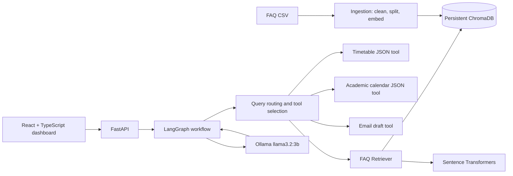

# CampusMind AI

CampusMind AI is a locally runnable, multi-tool campus helpdesk demo. It combines a persistent FAQ retrieval pipeline, a sample timetable and academic calendar, a LangGraph orchestration flow, Ollama with **`llama3.2:3b`**, a FastAPI service, and a React + TypeScript dashboard.

All policies, schedules, dates, contacts, and campus names in the included datasets are synthetic examples. They are not official university guidance. The demo interface does not provide authentication, access student records, or send email.

## Problem statement and objectives

Campus helpdesk questions often need more than one source: a handbook rule may need to be combined with a weekly class slot or an academic date. This project demonstrates a local assistant that retrieves grounded FAQ passages, looks up timetable and calendar JSON records, chooses relevant tools, and combines their actual results into one answer.

Objectives are to provide source-attributed policy lookup, exact sample schedule/event search, observable multi-tool execution, a local LLM-backed REST API, and a responsive frontend that consumes the live API.

## Features

- 40 sample FAQ entries validated from CSV and embedded as chunks using Sentence Transformers `all-MiniLM-L6-v2`.
- ChromaDB persistent vector storage, semantic similarity retrieval, relevance threshold, and FAQ source citations.
- Four campus tools: FAQ search, timetable lookup, academic calendar lookup, and email draft generation.
- LangGraph distinguishes attendance policy from unavailable personal attendance records, routes schedule/exam/calendar intents, streams timestamped execution events, and asks Ollama to synthesize only supplied evidence.
- FAQ sources include retrieved passages, category, source/document IDs, metadata, cosine distance, and `1 - distance` relevance. Timetable/calendar records remain separate tool evidence.
- FastAPI provides health, model health, standard and SSE chat, session activity, timetable, calendar, FAQ browsing/search, ingestion, recent activity, and stats.
- Responsive dark UI includes a live-data Dashboard, Assistant, Timetable, Academic Calendar, FAQ Explorer, Agent Activity, and Settings.
- Graceful fallback answer if the Ollama model cannot generate; tool errors are surfaced as failed events.

## Technology stack

- Python 3.11+, FastAPI, Pydantic, Uvicorn, Pandas, LangGraph, Ollama Python client.
- Sentence Transformers (`all-MiniLM-L6-v2`) and persistent ChromaDB.
- React 18, TypeScript, Vite, Tailwind CSS, React Router, Axios, Lucide React, and React Markdown.
- Pytest and FastAPI TestClient for automated checks; HTTPX for service integration.

## Architecture



### Retrieval and agent behavior

FAQ ingestion whitespace-cleans and validates the CSV, turns each question/answer into a document, chunks it, embeds it with `all-MiniLM-L6-v2`, and persists chunk text plus source/category/date metadata in ChromaDB. Search ranks by cosine similarity and filters below the configured threshold. A missing index or irrelevant search becomes a structured no-result, not an invented policy.

The LangGraph graph has a bounded three-node flow: query intent planning, actual selected tool execution, then concise answer synthesis. Ambiguous questions receive a short clarification. Individual attendance history is not in the dataset and is never inferred. Critical attendance, schedule, and exam facts are composed from the actual returned records. FAQ citations contain only documents genuinely retrieved by ChromaDB and remain separate from JSON tool evidence.

Available tools: `search_university_faq` (Chroma semantic retrieval), `check_timetable` (weekday/course/semester/section JSON filters and recurring next-slot calculation), `check_academic_calendar` (date/event/upcoming/weekday filters), and `generate_email_draft` (local draft only; never sends).

## Requirements

- Windows PowerShell, Python 3.11 or newer, Node.js 20 or newer, npm, and Ollama.
- Several gigabytes of disk for Python/embedding dependencies and the local model. Initial downloads require internet.

## Setup (Windows PowerShell)

From the project directory:

```powershell
Set-ExecutionPolicy -Scope Process Bypass
.\start.ps1 setup
ollama pull llama3.2:3b
```

The setup creates `.venv`, installs Python and frontend dependencies, and copies `.env.example` to `.env`. The default model tag is exact and is not substituted automatically. Make sure the Ollama service is running (the Ollama desktop app starts it on Windows).

Validate and ingest the sample datasets:

```powershell
.\.venv\Scripts\python.exe -m backend.app.cli validate
.\.venv\Scripts\python.exe -m backend.app.cli ingest --rebuild
```

The ingestion command validates CSV columns and row values, converts each FAQ to question/answer text, splits documents, generates normalized `all-MiniLM-L6-v2` embeddings, and upserts chunk IDs and source metadata into `backend/chroma_db`. Re-running without `--rebuild` safely upserts the same IDs. `--rebuild` clears the collection before ingestion.

### Dataset structure

- `backend/data/faq.csv`: `id`, `category`, `question`, `answer`, `source`, and ISO `last_updated`. The policies are labelled synthetic in their source metadata.
- `backend/data/timetable.json`: weekly class objects with day, subject, faculty, time, classroom/room, section, semester, and `sample_data: true`.
- `backend/data/academic_calendar.json`: event name, ISO date, event type, description, semester, and `sample_data: true`.

## Run the full application

Open three PowerShell terminals in the repository directory:

```powershell
# Terminal 1 — ensure the model is present and start the API
ollama pull llama3.2:3b
.\.venv\Scripts\python.exe -m uvicorn backend.app.main:app --host 127.0.0.1 --port 8000 --reload
```

```powershell
# Terminal 2 — React dashboard
Set-Location frontend
npm run dev
```

```powershell
# Terminal 3 — automated tests
.\.venv\Scripts\python.exe -m pytest backend/tests -q
```

Open the dashboard at <http://127.0.0.1:5173>, API docs at <http://127.0.0.1:8000/docs>, health at <http://127.0.0.1:8000/health>, and model health at <http://127.0.0.1:8000/health/llm>.

Convenience commands are `.\start.ps1 setup`, `.\start.ps1 validate`, `.\start.ps1 ingest`, `.\start.ps1 backend`, `.\start.ps1 frontend`, and `.\start.ps1 test`. Setup is run once; backend and frontend should run in separate terminals.

## Five multi-step demo queries

Ask each in the assistant UI or submit to `POST /chat`:

1. “What is the attendance requirement and when is my DBMS class on Monday?” — FAQ RAG and timetable.
2. “When is the next examination, and what are the reappear examination rules?” — FAQ RAG and academic calendar.
3. “Who should I contact for a leave application and help me draft an email to them?” — FAQ RAG and draft generation.
4. “Find my AI class on Tuesday and tell me whether any academic event is scheduled that day.” — timetable and weekday-filtered calendar.
5. “Tell me the minimum attendance requirement, my next DBMS class, and the next examination date.” — FAQ, timetable, and academic calendar.

The calendar next examination in the sample data is the next matching upcoming `Examination` event. `/chat` returns selected tools, structured FAQ sources, and observable execution events; `/chat/stream` emits events as SSE. Current live intent regression and stream examples are saved in [`docs/live-regression-evidence.json`](docs/live-regression-evidence.json) and [`docs/live-stream-evidence.json`](docs/live-stream-evidence.json).

### Observed live demo answers

These are excerpts from current requests to the running API with the real local Ollama model; evidence includes actual retrieved FAQ scores and tool selection.

1. **Attendance requirement:** “The retrieved sample FAQ lists at least 75% attendance in each course for end-semester exam eligibility.” The source card identifies `faq-001`, *Sample Student Handbook 2026*, score 0.6869.
2. **Personal attendance:** “Individual attendance records are not available in this synthetic dataset.” No tools ran.
3. **Attendance + Monday DBMS:** FAQ RAG and timetable returned 75% from the FAQ plus Monday 09:00–10:00 in C-204 from the matching timetable record.

The live multi-tool SSE sequence and `/agent/activity/{session_id}` lookup are recorded in [`docs/live-stream-evidence.json`](docs/live-stream-evidence.json).

## API

See [API_DOCUMENTATION.md](docs/API_DOCUMENTATION.md) and the Postman collection at `postman/CampusMind_AI.postman_collection.json`. Main endpoints:

| Method | Route | Purpose |
|---|---|---|
| GET | `/health` | API health |
| GET | `/health/llm` | Exact configured Ollama model availability |
| POST | `/chat` | Tool-routed answer, sources, and execution trace |
| POST | `/chat/stream` | Server-Sent Events for execution events and final answer |
| GET | `/agent/activity/{session_id}` | One session’s actual event timeline and result |
| GET | `/timetable` | JSON schedule filters: day, subject, semester, section |
| GET | `/calendar` | Calendar filters: event_type, upcoming, on_date |
| GET | `/faqs` | FAQ explorer data and optional query/category filter |
| GET | `/faqs/search?question=...` | Semantic FAQ retrieval with source and relevance |
| POST | `/ingest?rebuild=true` | Loopback-only ingestion trigger |
| GET | `/stats` | FAQ/vector store/tool/model status |
| GET | `/activity` | Actual in-process chat execution records |

Example request:

```powershell
Invoke-RestMethod -Method Post -Uri http://127.0.0.1:8000/chat -ContentType 'application/json' -Body '{"question":"What is the attendance requirement and when is my DBMS class on Monday?"}' | ConvertTo-Json -Depth 8
```

## Failure behavior

- Empty questions are rejected with HTTP 422.
- A missing model makes `/health/llm` report unavailable and the agent uses an evidence-only fallback composed from tool outputs; it never silently selects `llama3.2:latest`.
- Missing/corrupt data produces structured errors on data endpoints. An empty Chroma collection returns a no-result with an ingestion instruction.
- Missing FAQ/timetable/calendar evidence is represented by explicit no-result tool output. The model is instructed not to invent campus rules or schedule entries.
- Email drafts are marked “not sent”; no email transport is implemented.

## Five-minute demo

1. Start Ollama, run setup, pull `llama3.2:3b`, and ingest FAQs.
2. Start FastAPI and the Vite frontend in two terminals.
3. Open the dashboard and confirm API, vector store, and LLM status in the right rail.
4. Ask the attendance + Monday DBMS query. Expand its tool trace and source citation.
5. Visit timetable and confirm the returned DBMS record (Monday, 09:00–10:00, C-204).
6. Ask for the next examination and reappear rules; review the FAQ/calendar tool events.
7. Ask for a leave email draft; confirm it is a draft and is not sent.
8. Open Agent activity and FAQ explorer to inspect live backend records and sources.

## Testing and reports

```powershell
.\.venv\Scripts\python.exe -m pytest backend/tests -v
```

See [ARCHITECTURE.md](docs/ARCHITECTURE.md), [API_DOCUMENTATION.md](docs/API_DOCUMENTATION.md), [PROJECT_REPORT.md](docs/PROJECT_REPORT.md), and [TESTING_REPORT.md](docs/TESTING_REPORT.md). The test suite uses a mocked final-answer LLM in five routing/integration scenarios; a separate live Ollama and HTTP smoke run is recorded in the final testing report after execution.

## Screenshots

The interactive dashboard is served at `http://127.0.0.1:5173` when the frontend command above is running. The production build has been verified; no static screenshot is required to run or inspect the app.

## DoD implementation checklist

| DoD | Implementation | Verification status |
|---|---|---|
| 1 — data pipeline | FAQ CSV, timetable/calendar JSON, validation, chunking, Sentence Transformers embeddings, persistent ChromaDB | **PASS** — 40 FAQ records / 40 chunks; JSON loaders returned 16 timetable classes and 12 events |
| 2 — Llama 3.2 3B | Exact `llama3.2:3b` Ollama setting, health endpoint, real model prompt through chat | **PASS** — exact tag installed and healthy; standalone prompt and live chat answered |
| 3 — agent | LangGraph, four real tools, five multi-step scenarios, citations and fallbacks | **PASS** — 33 tests and five real HTTP scenarios with actual tool results |
| 4 — FastAPI | health, LLM health, HTTP `/chat`, timetable/calendar and supporting endpoints | **PASS** — actual Uvicorn server; HTTP endpoints and validation failures exercised |
| 5 — documentation | setup, demos, API, failure behavior, five-minute demo | **PASS** — three live answer examples and one documented no-result / invalid-input failure |

Synthetic data limitations: dates and policies are examples; timetable filters use sample semester/section; in-memory activity history clears on restart; email drafts are not sent; frontend demo profile is not authentication.

Possible next steps for an institution-specific deployment are replacing sample content with approved university records, adding authenticated student access, persisting activity/history, and integrating a campus mail provider behind an explicit send-confirmation step.

See [TESTING_REPORT.md](docs/TESTING_REPORT.md) for execution outputs and issue fixes. These statuses reflect this workspace's executed verification.
